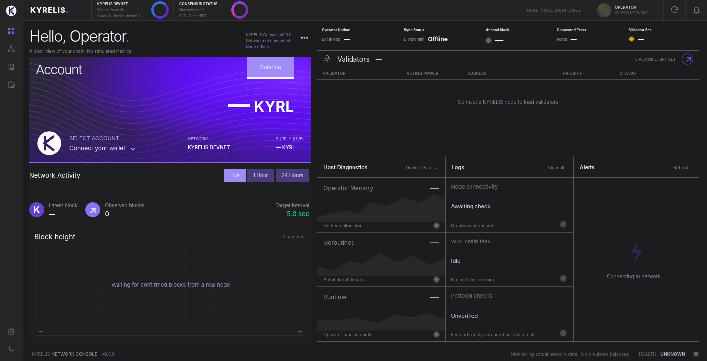

# KYRELIS Blockchain


KYRELIS je studentský blockchain postavený na Cosmos SDK. Z tohoto repozitáře si můžeš sestavit uzel a spustit vlastní síť s jedním validátorem. První spuštění vytvoří nový identifikátor sítě, genesis a místní účty. Při dalším spuštění uzel pokračuje se stejnými daty.

## Spuštění vlastní sítě

Potřebuješ **Go 1.26.5 nebo novější**, **Python 3.10+** a při prvním sestavení internet pro stažení modulů. Stáhni ZIP z nabídky **Code → Download ZIP** a rozbal jej, nebo použij Git.

| Prostředí | Spuštění z kořene projektu |
|---|---|
| Windows | Dvakrát klikni na **START.cmd** |
| Linux / macOS / Raspberry Pi s 64bitovým OS | Spusť **sh start.sh** |

Po sestavení zůstane uzel běžet v otevřeném terminálu. V prohlížeči otevři [stav místního uzlu](http://127.0.0.1:26657/status). V poli `result.sync_info.latest_block_height` sleduj přibývající bloky. Uzel zastavíš pomocí **Ctrl+C**.

### Vlastní název sítě

Při prvním spuštění můžeš zvolit chain ID a jméno validátoru:

```sh
python3 scripts/devnet.py start --chain-id skolni-sit-1 --moniker skolni-validator
```

Na Windows použij místo `python3` příkaz `py -3`. Další nezávislou síť založ v nové kopii projektu. Pro souběžný provoz více uzlů je potřeba přidělit jim různé porty.

### Webová peněženka

Nech uzel běžet a nainstaluj **Node.js 22.12+ s npm**, rozšíření Keplr a na Linuxu podporu Python venv. Ve druhém okně spusť **START-HUB.cmd** nebo **sh start-hub.sh**. Skript připraví virtuální prostředí, sestaví frontend a propojí Hub s chain ID z místní genesis. Otevři [lokální Hub](http://127.0.0.1:5173). Hub podporuje podpis přes Keplr, převody, delegaci, sledované účty a světlý i tmavý režim.

Nová adresa v Keplru začíná bez zůstatku. Pro první **lokální test** zkopíruj svou adresu z Hubu a na Linuxu použij:

```sh
./bin/kyrelisd tx bank send treasury TVOJE_ADRESA_KYR1 1000000ukyrl --from treasury --fees 500ukyrl --chain-id TVOJE_CHAIN_ID --home .local/node --keyring-backend test
```

Na Windows použij `bin\kyrelisd.exe`. Skutečné chain ID najdeš v odpovědi RPC pod `result.node_info.network`. Před potvrzením ověř příjemce i síť.

## Operátorská konzole



Samostatná konzole zobrazuje údaje z RPC. Spusť **START-CONSOLE.cmd** nebo **sh start-console.sh** a připoj ji k `http://127.0.0.1:26657`. Pro založení sítě podle tohoto návodu používej startovací skript v kořeni projektu.

## Parametry výchozí sítě

| Parametr | Výchozí hodnota |
|---|---|
| Nativní měna | 1 KYRL = 1 000 000 ukyrl |
| Genesis | 21 000 000 KYRL |
| Rozdělení | 1 000 KYRL validátorovi, 20 999 000 KYRL vývojové pokladně |
| Vlastní delegace při startu | 100 KYRL |
| Minimální poplatek převodu v aplikační logice | 100 ukyrl |
| Lokální RPC / REST | 26657 / 1317 |

## Orientace ve zdrojích

| Cesta | Co upravit |
|---|---|
| `chain/app` | Moduly sítě, emisní pravidla, adresní prefix a poplatky |
| `chain/cmd/kyrelisd` | Příkazy uzlu |
| `scripts/devnet.py` | Sestavení, rozdělení mincí při genesis a životní cyklus uzlu |
| `hub/web` | Webové rozhraní a integrace s Keplrem |
| `hub/server.py` | Ověření podpisu přihlášení a lokální účty |
| `operator` | Zdrojový kód operátorské konzole v Go |

Samostatné sestavení spustíš příkazem `python3 scripts/devnet.py build`. Příkaz `init` připraví genesis bez spuštění uzlu a `status` vypíše místní chain ID a výšku bloku. Změny ekonomiky a prefixu promítni také do konfigurace peněženky a testů.

### Data vývojové sítě

`.local/node` obsahuje databázi, identitu uzlu a testovací klíče validátoru a pokladny. Vývojový keyring ukládá klíče bez hesla. Používej jej pouze pro místní testovací prostředky a tuto složku nesdílej. Spouštěč používá loopback pro RPC, REST i P2P. Veřejný vícevalidátorový provoz vyžaduje vlastní správu klíčů, síťovou konfiguraci, zálohy a samostatné provozní ověření.

Původní licenční oznámení najdeš v `chain/LICENSE-Ignite` a `operator/LICENSE`.
