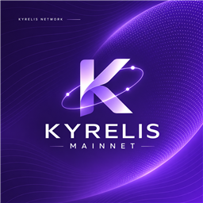

# KYRELIS

Oficiální repozitář studentské blockchainové sítě KYRELIS. Uchovává zdrojový kód uzlu a Hubu, konfiguraci provozovaných sítí a historii změn protokolu. Nativní měnou je **KYRL**. Jedna KYRL má milion mikrojednotek `ukyrl`.

**[Otevřít mainnetový Hub](https://blockchain.tail3fb8f3.ts.net:8443/) · [Otevřít devnetový Hub](https://blockchain.tail3fb8f3.ts.net/)**

| Síť | Chain ID | Použití |
|---|---|---|
| Mainnet | `kyrelis-2` | Peněženka, převody a staking KYRL |
| Devnet | `kyrelis-devnet-3` | Zkoušení aplikací a ověření změn před mainnetem |

## Začít používat KYRELIS

Otevři Hub a vyber **Připojit Keplr**. Před potvrzením zkontroluj chain ID. Obě sítě mohou pro stejný účet zobrazit stejnou adresu `kyr1…`, každá ale vede vlastní zůstatky. Windows spouštěč `START.cmd` otevře mainnet v prohlížeči.

## Dokumentace

- [Peněženka, adresy sítí a API](docs/networks.md)
- [Provoz uzlu, ověření stavu a obnova](docs/operations.md)
- [Verzování, sestavení a postup vydání](docs/releases.md)
- [Historie změn](CHANGELOG.md) · [Konfigurace pro nástroje](networks/)
- [Přispívání](CONTRIBUTING.md) · [Hlášení bezpečnostního problému](SECURITY.md)

## Co je ve zdrojích

`chain/` obsahuje aplikaci Cosmos SDK a příkaz `kyrelisd`. V `hub/` je webová peněženka a explorer. `operator/` obsahuje servisní konzoli. Vývojářské nástroje pro místní testy jsou popsané v průvodci vydáním. K používání veřejného Hubu stačí prohlížeč.
